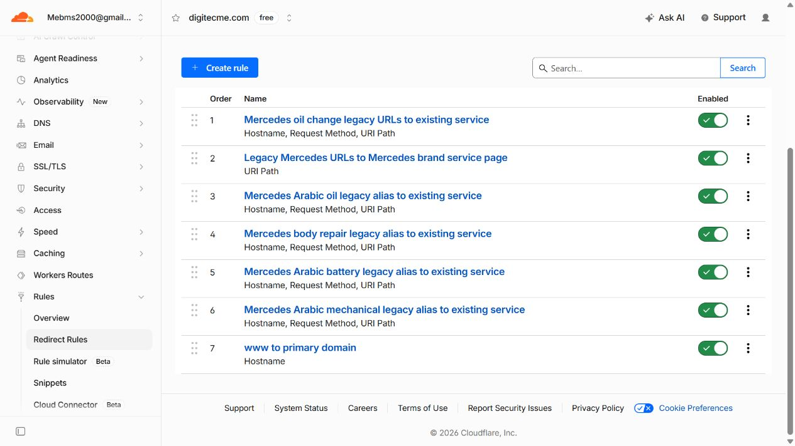

# Phase 2A deployment evidence — stopped on verification failure

Exactly R1, R2, R3 and R4 were added and enabled. R1–R3 passed their individual activation checkpoints; R4 failed one required request. All four remain enabled. No rollback or later live change was made.

- [Deployment report](deployment-report.md): release gates, exact IDs/times, before/after observations, scope and approval decisions.
- [Verification report](verification/verification-report.md) and [R4 failure](verification/evidence/checkpoint-R4-2026-10-26T07-20-57-862Z/FAILURE.md).
- [Before inventory](cloudflare/before-inventory.json), [after inventory](cloudflare/after-inventory.json) and [799-check comparison](cloudflare/after-conflict-check-output.json).
- [192 sequential before/after source cases](verification/new-rule-before-after-192-cases.csv); this is not the withheld final 326-case matrix.
- [Activation log](cloudflare/activations.json): submission and observed-enabled timestamps, not internal provider activation timestamps.
- [R4-only rollback proposal](cloudflare/R4-rollback-proposal.json): requires separate explicit approval; no operation executed.

The exact failed request was GET `https://digitecme.com/ar/brands/mercedes-benz-service-dubai/mechanical-repair`, without a trailing slash or query. It returned homepage 200 instead of a direct 308. The cause remains unresolved. The final full post-deployment test was withheld after this failure, and no retry replaced the failed observation.

