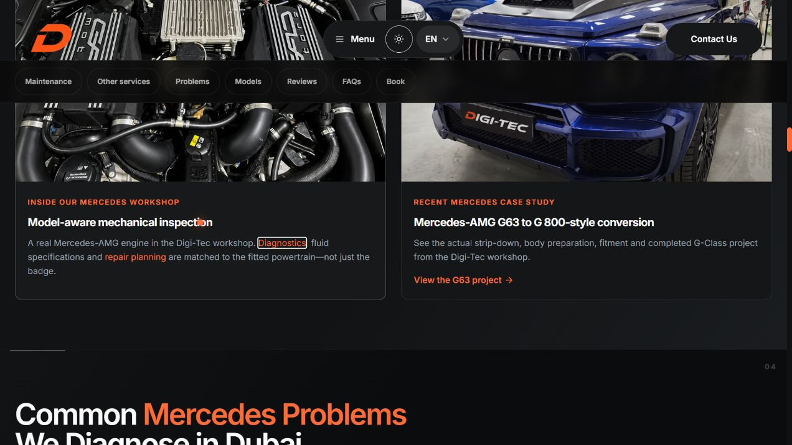
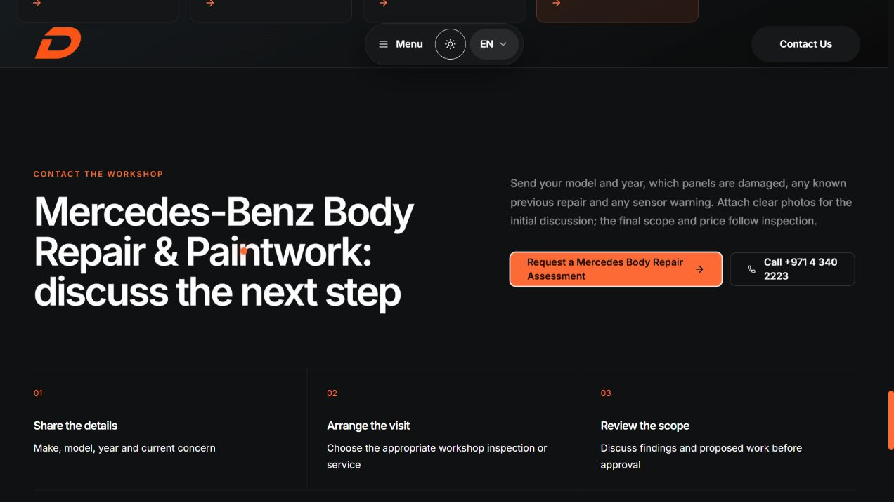
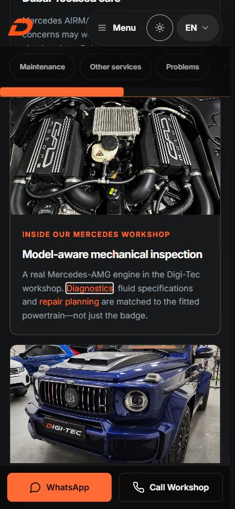

# Local browser validation

The candidate build was inspected with the in-app Chromium browser on 26 October 2026. Read-only production tests are recorded separately under `../redirects/`; these screenshots show the local candidate.

- Desktop: 1272 × 720 browser viewport; relevant section states plus full-page captures.
- Responsive: 390 × 844 and 320 × 844 CSS iframes, same desktop browser engine. Frame widths, document widths and focus data are recorded in [observations.json](observations.json). The page-wide document did not overflow horizontally in these tested states. The hub’s section navigator intentionally scrolls horizontally inside its own region.
- Keyboard: real Tab/Shift+Tab/Enter interactions on the new caption links, workshop phone and final body actions; FAQ expansion/collapse and menu Enter/Escape focus restoration. Native-index targeting was also used to inspect/activate the three body placements; that is recorded separately from sequential Tab checks.
- Contact navigation: intercepted locally, retaining the exact href, recipient, message and placement. No external contact was made. External analytics/connections were blocked by the preview-only CSP; no event delivery or lead receipt is inferred.
- [Six local GET/HEAD destination checks](local-http.json) return 200 without redirects. Browser keyboard activation opens the relevant diagnostics/mechanical pages, with saved destination AX evidence.
- [Console capture](console-log.json) returned no warning/error entries. This is the browser API capture’s scope, not proof of every possible runtime/third-party condition.

The QA server adds instrumentation to local responses only; application source and built assets remain unchanged. Initial screenshot frames containing shell context remain in the evidence; final `*-frame.png` hub captures and the body final-guidance captures are the relevant review images. Some focus-event rectangles precede automatic scrolling; the screenshot is the evidence for the final visible state. The baseline did not undergo a separate visual screenshot matrix: baseline/candidate rendered HTML and metadata were compared independently.

Physical iOS/Android, touch, native app handoff, connected calls, received WhatsApp messages, full accessibility conformance and analytics delivery are outside these local checks. No credentials, real customer data or contact form were submitted.

## Desktop caption

## Desktop body guidance

## 390px hub caption

## 320px body guidance

