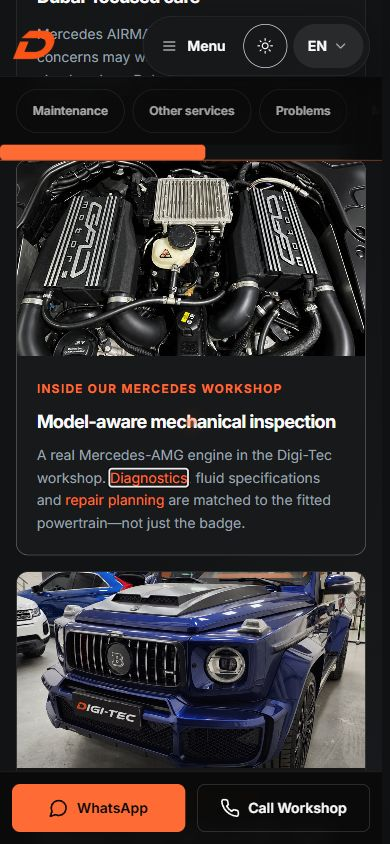
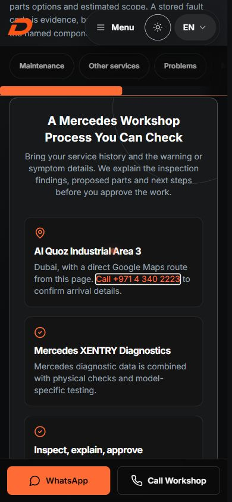
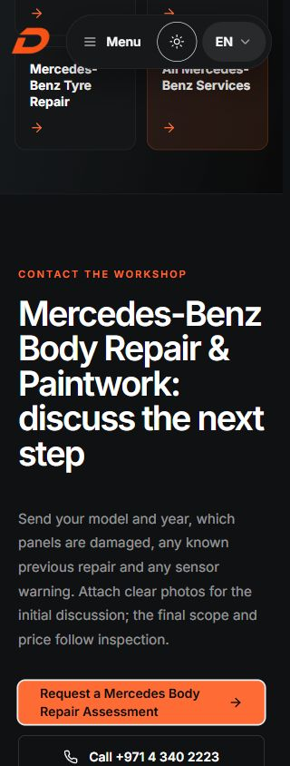

# Local artifact browser verification

Verified on 26 October 2026 against selected frozen-pnpm A and B artifacts. [Raw observations](observations.json), [console log](browser-console.json), and adjacent `.ax.txt` snapshots preserve the actual observations. `../preview-qa.mjs` serves loopback only, injects QA code into responses rather than artifacts, blocks external analytics/connections and intercepts telephone/WhatsApp anchors. No message, call or production change occurred.

Both options were opened on the English hub and body page at desktop and 390/320 CSS-pixel frame widths. Measured `scrollWidth === clientWidth` at every captured responsive state. These are responsive frames in a desktop browser engine, not physical-mobile or touch-device tests. The two completed artifacts differ only in their sitemap, so their application HTML/assets are identical.

Sequential Tab reaches the two new hub service links and new workshop phone. Enter activates the intended diagnostics/mechanical destination or captures `tel:+97143402223` with `workshop_proof` attribution. Body hero, scope and final assessment anchors preserve recipient `97143402223`, the same complete model/panels/repair/sensor/photo draft and their individual placement labels. Final phone retains `final_cta`. The 320px final assessment CTA remains visible with a keyboard focus outline. FAQ Enter expands; Menu Enter/Escape collapses and restores Menu focus. The initial pointer-open menu check returned focus to its previous element; the explicit keyboard check is recorded separately.

One A-tab console entry reports an unattributed `MutationObserver.observe` non-Node error. It has no source/stack in the browser log. B initially has no warnings/errors. A fresh tab then performed three hub→diagnostics→back→body→390px-frame sequences for each unchanged baseline/A/B: the same error was logged once during B sequence 3; all nine journeys completed. [Exact sequence times and logs](console-repeat-investigation.json).

Ten further B sequences used a diagnostic QA response script that records window error filename, line, column and stack; no new warnings/errors occurred, so it did not obtain an attribution. [Diagnostic observations](console-error-probe.json). This is an intermittent unresolved console finding, not a successful-retry claim of global safety. It is not proven pre-existing and not established as an approved-patch defect. The only matching application observer predates the patches and requires a URL fragment; the new service links have none. [Independent source/log assessment](../tests/observer-console-review.md). Do not change unrelated code to hide the observation. Resolve or explicitly review this finding before unconditional release approval.

Desktop approved link focus:

Mobile 390px approved service links:

Mobile 390px workshop telephone:

Narrow 320px body enquiry focus:

The screenshots show local candidates. Existing claims/reviews outside the patches are unchanged and are not newly invented by this package. Local preview imports the built `_worker.js`; its routing behavior is not a claim that this worker executes in production.
